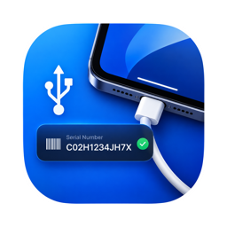
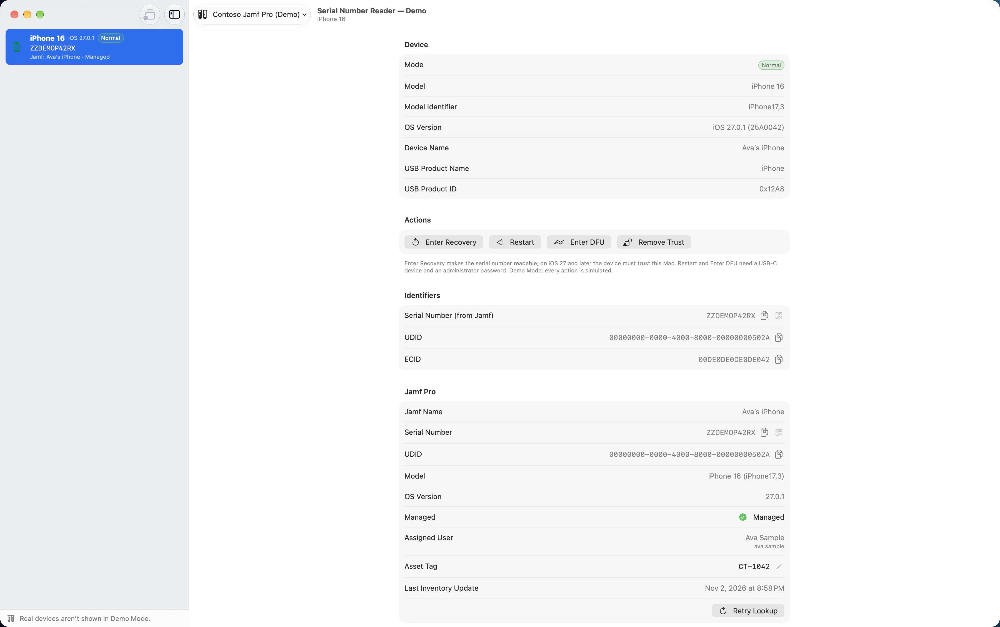
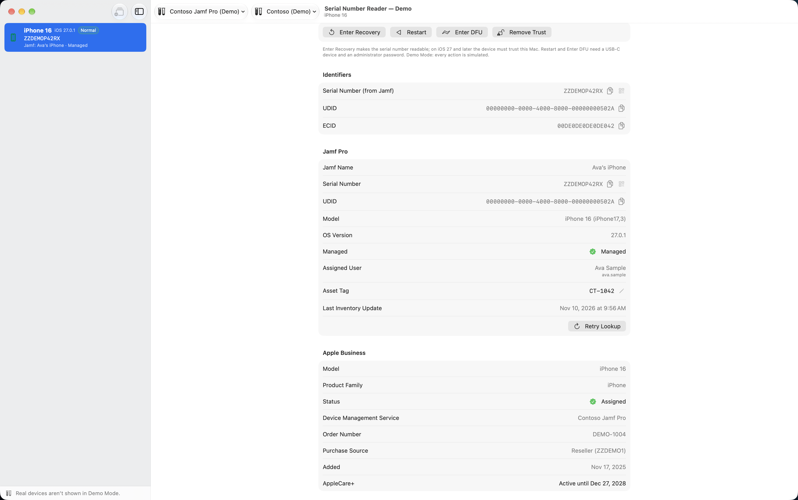

  

# Serial Number Reader

*Read serial numbers from plugged-in iPhones, iPads and Macs and look them up in Jamf, Apple Business and Apple School Manager.*

A native macOS app that identifies connected iPhones, iPads and Macs by serial number — **including devices that won’t boot** — and optionally looks them up in Jamf Pro or Jamf School. Built for handling devices with no readable printed serial.

## Features

- **Live USB detection** of Apple devices in Normal, Recovery and DFU mode. Detection uses only IOKit (no `libimobiledevice`).
- **Normal mode** — reads the device UDID, model, OS version and device name (no pairing or trust needed) and resolves the device in Jamf.
- **Recovery mode** — reads the serial number and ECID directly from the USB descriptor; the model is resolved from the CPID/BDID pair.
- **DFU mode** — detects the device and shows the model-specific button sequence to reach Recovery. Current devices expose no identifiers over USB in DFU; with Apple Configurator installed, the model, ECID and UDID are filled in automatically, and the serial number follows from Jamf (iPhones and iPads as mobile devices, Macs as computers).
- **Restore and Revive** — for devices in DFU or Recovery mode, through Apple Configurator: **Restore** erases the device and installs the latest or a specific IPSW (checked against the model and Apple’s signing status before anything is erased; a device whose model is unknown can only get the latest version); **Revive** reinstalls the OS and keeps the content. One device at a time, with a progress banner and log; quitting during a restore asks first.
- **Jamf Pro and Jamf School lookup** by serial or UDID — Jamf Pro directly or through the **Jamf Platform API** — showing the device’s Jamf name, serial, UDID, model, OS version, managed state, assigned user and last inventory date, with an **editable asset tag** and a link to the record.
- **Apple Business and Apple School Manager lookup** (optional) — once the serial number is known (read in Recovery mode, or from Jamf in Normal mode), the device is looked up in your organization’s Apple Business or Apple School Manager: model, product family, status (assigned, unassigned or released), assigned device management service, order number, purchase source, date added and AppleCare coverage with its end date, plus an **Open in Apple Business** or **Open in Apple School Manager** link to the portal. Nothing is shown, and Apple is never contacted, until an Apple account is saved.
- **Several saved connections** — Jamf connections and Apple accounts in one list in **Settings › Connections**. Switch the Jamf connection, and the Apple account, with the pickers in the toolbar or the **Connection** menu.
- **Mode switching without button presses** — send a booted device into Recovery mode (and read its serial hands-free), boot a Recovery-mode device back to normal, or Restart / Enter DFU a USB-C device, even when it’s unresponsive.
- **Session export** — save every device from the session as CSV (**File › Export Session…**, ⌘E), or copy all serial numbers at once (**File › Copy All Serial Numbers**, ⇧⌘C). **Clear Disconnected** (toolbar and File menu) and **Remove from List** (right-click, the Delete key, or **Device › Remove from List**, ⌘⌫) tidy the list.
- **Activity log** — **Window › Activity Log** (⇧⌘L) lists every sign-in, lookup, asset tag change, connection test and USB action. **Export for Bug Report…** replaces serial numbers, UDIDs, ECIDs, Apple order numbers and reseller IDs, usernames and IP addresses with placeholders; **Export Unmasked…** and **Copy Entry** keep them. The log is kept in memory only.
- **Demo Mode** — try the app without a device or a Jamf tenant: a pretend iPhone, the sample Jamf servers “Contoso Jamf Pro (Demo)” and “Contoso Academy (Demo)”, and the sample Apple Business organization “Contoso (Demo)”. Every action on the pretend iPhone is simulated; nothing is sent to a device or a tenant, and real devices are hidden while it’s on. Turn it on with **Try Demo Mode** in the sidebar when no device is connected, or with **Demo Mode** in the toolbar’s connection picker or the **Connection** menu (dimmed while an action or restore runs).
- **Device menu** — the selected device’s actions (Enter Recovery, Boot to Normal, Restart, Enter DFU, Restore…, Revive…, Remove Trust, Retry Lookup ⌘R) are also in the menu bar, for the keyboard and Full Keyboard Access.
- **Copy buttons** and a scannable **QR code** for the serial number.

## Requirements

- macOS 14 or later.
- USB-C power actions (Restart / Enter DFU) require a Mac with Apple silicon (they’re unavailable on an Intel Mac, and while the app runs under Rosetta) and a USB-C target device connected **directly** to a USB-C port of the Mac, and prompt for an administrator password. The command goes only to the selected device’s own port, so other devices, chargers and displays on other ports don’t matter; a device behind a hub, dock or adapter is refused, because the command would reach the hub instead. Before asking for the password, the app checks which port the device is on and dims the buttons with the reason when it can’t tell.
- Restore, Revive, Remove Trust and DFU identification require [Apple Configurator](https://apps.apple.com/app/apple-configurator/id1037126344) (free). Serial Number Reader uses its command-line tool; no setup is needed.

## Installation

Download the latest build from [Releases](../../releases), unzip, and move **Serial Number Reader.app** to your Applications folder. The app is signed with a Developer ID and notarized by Apple. Once a day the app asks GitHub whether a newer version exists; turn this off with **Check for updates daily** in **Settings › Updates**, or check now with **Serial Number Reader › Check for Updates…**.

## Usage

Connect a device over USB. It appears in the sidebar with its mode; select it to see full details.

| Mode | What you get | Actions |
| --- | --- | --- |
| Normal | UDID, model, OS version, then Jamf record (serial, user, asset tag, …) | Enter Recovery · Restart · Enter DFU · Remove Trust (when the device trusts this Mac) |
| Recovery | Serial number + ECID read directly; model from CPID/BDID; Jamf record | Boot to Normal · Restore · Revive · Restart · Enter DFU |
| DFU | Model, ECID and UDID via Apple Configurator; Jamf record; steps to enter Recovery mode | Restore · Revive · Restart |

Enter Recovery, Boot to Normal, Restore and Revive need no administrator password; Restart and Enter DFU use USB-C power delivery and prompt for one. Before asking, the app checks that its own app on disk is the signed one that is running. Only one action runs at a time, and none while a Restore or Revive runs.

After Restart, Enter DFU and Restore the app waits until the same device (by its ECID) appears again in the expected mode, and only then reports success; when the device doesn’t come back, it says so. After Restart and Enter DFU a bar above the device details names the device and says how long the app waits, with **Stop Waiting**; other devices can be used meanwhile. A restarted iPhone or iPad appears again only once it’s unlocked, and a Mac that starts up normally doesn’t appear on USB at all: the app then says the command was sent and to unlock the device to see it again.

> **Mac DFU:** connect the cable to the Mac’s DFU port, which depends on the model ([How to identify the DFU port on Mac](https://support.apple.com/120694)), leave its other USB ports empty except for power, and click **Allow** if your Mac asks to allow the accessory to connect.

> **iOS 27 and later:** Enter Recovery only works from a Mac the device trusts. Unlock the device and tap **Trust** once, or enter Recovery mode with the buttons — the app shows the steps for the model. **Remove Trust** deletes the pairing again afterward.

> **Note on booted devices:** an iPhone or iPad that hasn’t been unlocked since power-on doesn’t enumerate over USB (iOS USB restricted mode). Unlock it once, or put it into Recovery mode to read the serial.

### Jamf Pro and Jamf School

Open **Settings › Connections** and add a connection with **+**. **Test Connection** checks it. Each connection is one of:

- **Jamf Pro**, signing in with an **API client** or a **Username and password** — enter your Jamf Pro server URL and credentials. The account needs read access to mobile devices, and to computers for looking up Macs (and update access to edit asset tags).
- **Jamf Platform API** — create an integration in [Jamf Account](https://account.jamf.com) scoped to a **platform environment**, with the `devices:read` permission (plus `devices:update` to edit asset tags). Enter its region, client ID, client secret and environment ID. The Jamf Pro URL is optional and only used for “Open in Jamf Pro” links. Integrations expire after six months.
- **Jamf School** — enter your Jamf School URL, Network ID and an API key (Organization › Settings › API) with read access to devices, plus write access to edit asset tags.

Settings from versions before saved connections are converted once, automatically; the old settings are left as they were.

### Apple Business and Apple School Manager

This is optional; without an Apple account the app never contacts Apple Business or Apple School Manager and shows no section for it.

**Create the API account.**

1. Sign in to [Apple Business](https://business.apple.com) or [Apple School Manager](https://school.apple.com) and open the **API** section of the preferences (your name at the bottom of the sidebar → Preferences → API).
2. The app only reads. Create an API account for this app alone, so you can revoke it on its own.
3. Download the **private key** (a `.pem` file) when it is shown — Apple shows it only once — and note the **Client ID** and **Key ID**.

**Configure the app.** Open **Settings › Connections**, add a connection with **+** and choose **Apple Business** or **Apple School Manager**. Enter the Client ID and Key ID, paste the private key or import the `.pem` file, then click **Test Connection**. The first Apple account you save is the one in use; with several, choose it with the toolbar picker, the **Connection** menu or **Use This Account**. Select a device in the sidebar: its Apple section appears below the Jamf section once the serial number is known. The app signs in with OAuth 2.0 client credentials and a short-lived ES256 client assertion, and keeps the access token until shortly before it expires. Apple allows about 20 requests a minute per organization; the app stays under that and waits when asked to.

The **Open in Apple Business** (or **Open in Apple School Manager**) link opens the portal’s start page (Apple documents no address for a single device); use the serial number’s copy button in the Device section to search for it there.

The CSV export has two extra columns at the end, **Apple Business Status** and **Apple Business Device Management Service**, filled for devices that were looked up.

### Where data is stored

- **Jamf connections** — as JSON in the app’s preferences (UserDefaults key `jamfConnections`, the one in use under `activeJamfConnectionID`), without secrets.
- **Secrets** (client secrets, passwords, API keys) — in the macOS Keychain, service `be.jordythery.SerialNumberReader.jamf`, never in preferences.
- **Apple Business and Apple School Manager accounts** — name, client ID and key ID as JSON in the app’s preferences (UserDefaults key `appleBusinessConnections`, the one in use under `activeAppleBusinessConnectionID`); the private key in the Keychain, service `be.jordythery.SerialNumberReader.appleBusiness`, never in preferences or logs.
- **Activity log** — in memory only; nothing is written to disk unless you export it.
- **System log** — serial numbers, UDIDs, ECIDs and server answers are logged as private, so macOS hides them in Console.

### Device model data

The CPID/BDID → model mapping lives in [`AppleDeviceModels.json`](Serial%20Number%20Reader/AppleDeviceModels.json) as a bundled resource, covering iPhone 8 and later, all iPads from 2017 onward, and every Apple silicon Mac, from the first M1 models of 2020 onward. A model that isn’t listed shows as unknown in Recovery and DFU, and a Restore can then only install the latest version. It can be updated without code changes.

### Network use

Besides Jamf Pro or Jamf School, the app contacts Apple Business and Apple School Manager, only when an Apple account is saved: `account.apple.com` to sign in, and `api-business.apple.com` or `api-school.apple.com` for lookups (read only). It also contacts GitHub (update check, can be turned off) and, when preparing a Restore, the public [ipsw.me](https://ipsw.me) data to show the latest signed version and check an IPSW’s signing status — only the model identifier and build number are sent. For a Restore without a chosen IPSW, and for a Revive, Apple Configurator downloads the software from Apple.

## Building from source

Open `Serial Number Reader.xcodeproj` in Xcode 26 or later and build the **Serial Number Reader** scheme. The app’s only package dependency is [JTKit](https://github.com/JordyThery/JTKit), the shared package of these apps (version pinned in `Package.resolved`); resolving it also downloads Microsoft’s MSAL, which JTKit uses for Intune sign-in and which this app doesn’t link or ship. Unit tests (Swift Testing) cover the USB descriptor parser, UDID and ECID handling, Configurator output parsing, IPSW checks, usbmuxd and lockdown framing, the pairing checks of the trusted connection, the safeguards of the power actions, connection conversion, the Jamf networking (on a fake server), the Apple Business and Apple School Manager lookup (sign-in request and signature, token caching, read-only requests, results and errors on a fake server, accounts saved apart from the Jamf connections), the CSV export, the device list, the activity log entries, Demo Mode, the guard that keeps tests away from real USB devices and saved connections, and the acknowledgement. A UI smoke test runs the app in Demo Mode, including the Apple section of the pretend iPhone.

The app runs outside the App Sandbox: it needs direct IOKit access for USB enumeration, and the USB-C power actions use the private `AppleHPM` port-controller interface, which requires root (the app re-launches itself with administrator privileges for those actions only).

## Architecture

- `USBDeviceMonitor` — wraps IOKit USB arrival/removal notifications and publishes an observable device list; the UI consumes only this.
- `DescriptorParser` — pure, unit-tested parsing of the Recovery/DFU USB serial descriptor and UDID normalization.
- `ModelDatabase` — loads the bundled CPID/BDID model map.
- `USBHardware` / `DemoUSB` — the one doorway to real devices (lockdown, iBoot, the power actions, `cfgutil`), and Demo Mode’s pretend iPhone, which never reaches it.
- `JamfClient` / `JamfStore` — the app’s Jamf lookups and asset-tag updates on JTKit’s Jamf Pro (direct or through the Platform API gateway) and Jamf School clients, and their UI-facing state.
- `AppleBusinessStore` / `AppleBusinessConnection` — the optional Apple Business and Apple School Manager lookup on JTKit’s Apple Business client (`ABM.Client`: OAuth with a signed client assertion, token caching, rate limit), its UI-facing state per serial number, and the saved API accounts. `AppleBusinessText` words the values for the detail view and the CSV export.
- `AppConnections` / `JamfConnection` / `LegacySettingsConversion` — the saved Jamf connections and Apple accounts as one list for JTKit’s Settings › Connections (each kind kept in its own setting and Keychain service), and the one-time conversion of older settings.
- `Usbmux` / `LockdownTLS` — minimal usbmuxd/lockdown client: unpaired device details, and Enter Recovery — unpaired, or over a trusted (paired) TLS session where iOS requires it.
- `Configurator` / `RestoreController` — runs Apple Configurator’s `cfgutil` to identify devices, Restore, Revive and remove trust, and tracks a running Restore or Revive.
- `SessionExport` — CSV export and serial list built from the session’s device list.
- `VDMTool` / `DeviceActionController` — USB-PD vendor-defined-message power actions via `AppleHPM`, and the other device actions.
- `RecoveryCommands` — Boot to Normal from Recovery mode (iBoot commands).
- `AppDemo` — the Demo Mode switch.
- `UnderTest` — the guard that refuses every USB action and saved-connection request under tests.
- `BlockingWork` — runs blocking USB work and child processes off the main thread.
- `AboutInfo` — the About window and the acknowledgement.

## Credits

The Apple Business and Apple School Manager lookup was contributed by [Everette G. Allen](https://github.com/everetteallen).

USB-PD VDM power actions are derived from [AsahiLinux/macvdmtool](https://github.com/AsahiLinux/macvdmtool) and [osy/ThunderboltPatcher](https://github.com/osy/ThunderboltPatcher) (Apache-2.0); attribution is retained in the relevant source files. The full license is in [THIRD-PARTY-NOTICES.md](THIRD-PARTY-NOTICES.md) and in the app’s About window.

## Support

If Serial Number Reader saves you time, you can [buy me a coffee](https://buymeacoffee.com/jordythery). ☕️

## Disclaimer

This tool is provided as-is, without warranty of any kind. Use it at your own risk. This is a personal project. It is not affiliated with or endorsed by my employer, Jamf or Apple. Issues and pull requests are appreciated. Support is best-effort.

## License

[MIT](LICENSE)
