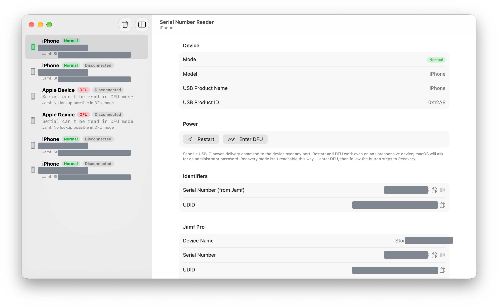

# Serial Number Reader

A native macOS app that identifies connected iPhones, iPads and Macs by serial number — **including devices that won't boot** — and optionally looks them up in Jamf Pro. Built for handling devices with no readable printed serial.

## Features

- **Live USB detection** of Apple devices in Normal, Recovery and DFU mode, using IOKit (no private device frameworks, no `libimobiledevice`).
- **Normal mode** — reads the device UDID, model, OS version and device name (no pairing or trust needed) and resolves the device in Jamf Pro.
- **Recovery mode** — reads the serial number and ECID directly from the USB descriptor; model is resolved from the CPID/BDID pair.
- **DFU mode** — detects the device and shows the model-specific button sequence to reach Recovery. Current devices expose no identifiers over USB in DFU; with Apple Configurator installed, the model, ECID and UDID are filled in automatically, and the serial number follows from Jamf.
- **Restore and Revive** — for devices in DFU or Recovery mode, through Apple Configurator: **Restore** erases the device and installs the latest or a specific IPSW (checked against the model and Apple's signing status before anything is erased); **Revive** reinstalls the OS and keeps the content. One device at a time, with live progress.
- **Jamf Pro and Jamf School lookup** by serial or UDID — Jamf Pro directly or through the **Jamf Platform API** — showing device name, serial, UDID, model, OS version, managed state, assigned user and last inventory date, with an **editable asset tag** and a link to the record.
- **Session export** — save every device from the session as CSV (**File → Export Session…**), or copy all serial numbers at once.
- **Mode switching without button presses** — send a booted device into Recovery mode (and read its serial hands-free), boot a Recovery-mode device back to normal, or Restart / Enter DFU any USB-C device over any port, even when it's unresponsive.
- **Copy buttons** and a scannable **QR code** for the serial number.

## Requirements

- macOS 14 or later.
- USB-C power actions (Restart / Enter DFU) require an Apple Silicon Mac host and a USB-C target device, and prompt for an administrator password.
- Restore, Revive, Remove Trust and DFU identification require [Apple Configurator](https://apps.apple.com/app/apple-configurator/id1037126344) (free). Serial Number Reader uses its command-line tool; no setup is needed.

## Installation

Download the latest build from [Releases](../../releases), unzip, and move **Serial Number Reader.app** to your Applications folder. The app is signed with a Developer ID and notarized by Apple.

## Usage

Connect a device over USB. It appears in the sidebar with its mode; select it to see full details.

| Mode | What you get | Actions |
| --- | --- | --- |
| Normal | UDID, model, OS version, then Jamf record (serial, user, asset tag, …) | Enter Recovery · Restart · Enter DFU · Remove Trust |
| Recovery | Serial number + ECID read directly; model from CPID/BDID; Jamf record | Boot to Normal · Restore · Revive · Restart · Enter DFU |
| DFU | Model, ECID and UDID via Apple Configurator; Jamf record; steps to enter Recovery mode | Restore · Revive · Restart |

Enter Recovery, Boot to Normal, Restore and Revive need no administrator password; Restart and Enter DFU use USB-C power delivery and prompt for one.

> **iOS 27 and later:** Enter Recovery only works from a Mac the device trusts. Unlock the device and tap **Trust** once, or enter Recovery mode with the buttons — the app shows the steps for the model. **Remove Trust** deletes the pairing again afterwards.

> **Note on booted devices:** an iPhone or iPad that has not been unlocked since power-on does not enumerate over USB (iOS USB restricted mode). Unlock it once, or put it into Recovery mode to read the serial.

### Jamf Pro and Jamf School

Open **Settings** and choose how to connect:

- **API Client (OAuth)** or **Username & Password (Classic)** — enter your Jamf Pro server URL and credentials. The account needs read access to mobile devices and computers (and update access to edit asset tags).
- **Jamf Platform API** — create an integration in [Jamf Account](https://account.jamf.com) scoped to a **platform environment**, with the `devices:read` permission (plus `devices:update` to edit asset tags). Enter its region, client ID, client secret and environment ID. The Jamf Pro URL is optional and only used for "Open in Jamf Pro" links. Integrations expire after six months.

- **Jamf School** — enter your Jamf School URL, Network ID and an API key (Organization → Settings → API) with read access to devices, plus write access to edit asset tags.

Secrets are stored in the macOS Keychain, never in preferences.

### Device model data

The CPID/BDID → model mapping lives in [`AppleDeviceModels.json`](Serial%20Number%20Reader/AppleDeviceModels.json) as a bundled resource, covering iPhone 8 and later, all iPads from 2017 onward, and Apple Silicon Macs. It can be updated without code changes.

### Network use

Besides Jamf Pro or Jamf School, the app contacts GitHub (update check, can be turned off) and, when preparing a Restore, the public [ipsw.me](https://ipsw.me) data to show the latest signed version and check an IPSW's signing status — only the model identifier and build number are sent.

## Building from source

Open `Serial Number Reader.xcodeproj` in Xcode and build the **Serial Number Reader** scheme. No third-party dependencies. Unit tests (Swift Testing) cover the USB descriptor parser, UDID and ECID handling, Configurator output parsing, IPSW checks, the Jamf configuration and the CSV export.

The app runs outside the App Sandbox: it needs direct IOKit access for USB enumeration, and the USB-C power actions use the private `AppleHPM` port-controller interface, which requires root (the app re-launches itself with administrator privileges for those actions only).

## Architecture

- `USBDeviceMonitor` — wraps IOKit USB arrival/removal notifications and publishes an observable device list; the UI consumes only this.
- `DescriptorParser` — pure, unit-tested parsing of the Recovery/DFU USB serial descriptor and UDID normalisation.
- `ModelDatabase` — loads the bundled CPID/BDID model map.
- `JamfClient` / `JamfSchoolClient` / `JamfStore` — async Jamf Pro client (direct or through the Platform API gateway) and Jamf School client (token caching, serial/UDID lookup, asset-tag update), and its UI-facing state.
- `Usbmux` / `LockdownTLS` — minimal usbmuxd/lockdown client: unpaired device details, and Enter Recovery — unpaired, or over a trusted (paired) TLS session where iOS requires it.
- `Configurator` / `RestoreController` — runs Apple Configurator's `cfgutil` to identify devices, Restore, Revive and remove trust, and tracks a running Restore or Revive.
- `SessionExport` — CSV export and serial list built from the session's device list.
- `VDMTool` / `DeviceActionController` — USB-PD vendor-defined-message power actions via `AppleHPM`, and the other device actions.

## Credits

USB-PD VDM power actions are derived from [AsahiLinux/macvdmtool](https://github.com/AsahiLinux/macvdmtool) and [osy/ThunderboltPatcher](https://github.com/osy/ThunderboltPatcher) (Apache-2.0); attribution is retained in the relevant source files. The full licence is in [THIRD-PARTY-NOTICES.md](THIRD-PARTY-NOTICES.md) and in the app's About window.

## Support

If Serial Number Reader saves you time, you can [buy me a coffee](https://buymeacoffee.com/jordythery). ☕️

## License

[MIT](LICENSE)
